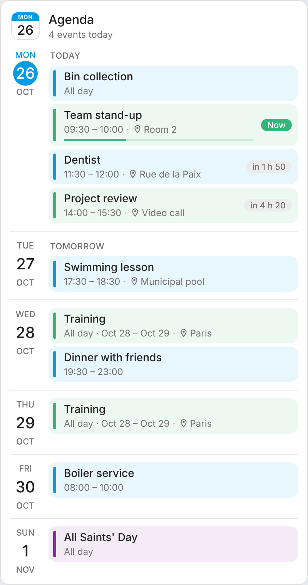
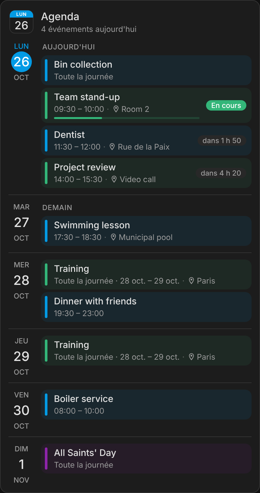
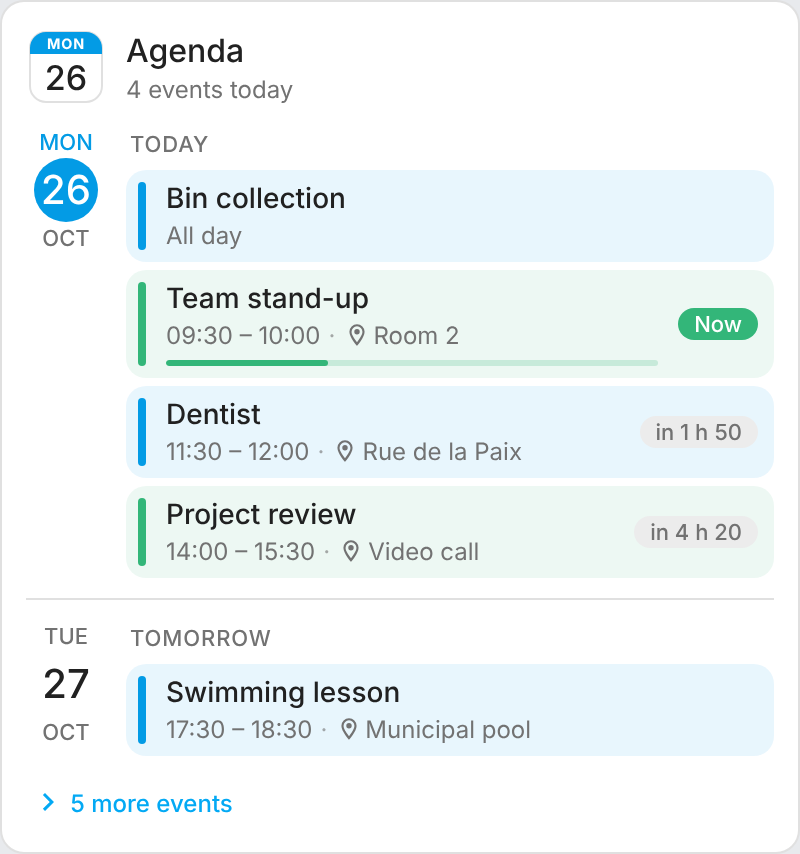
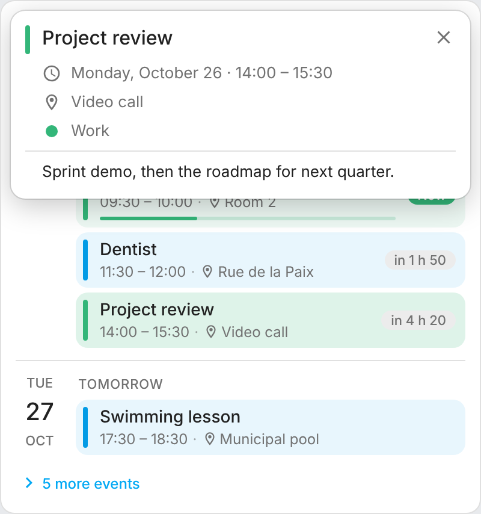
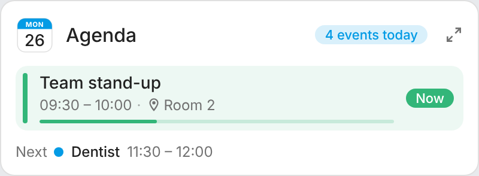
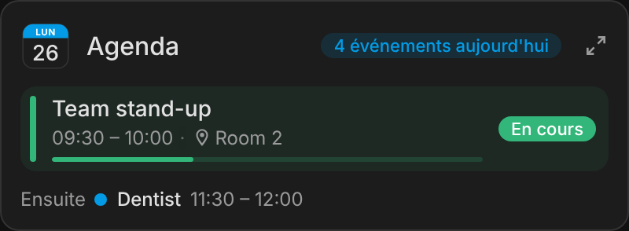
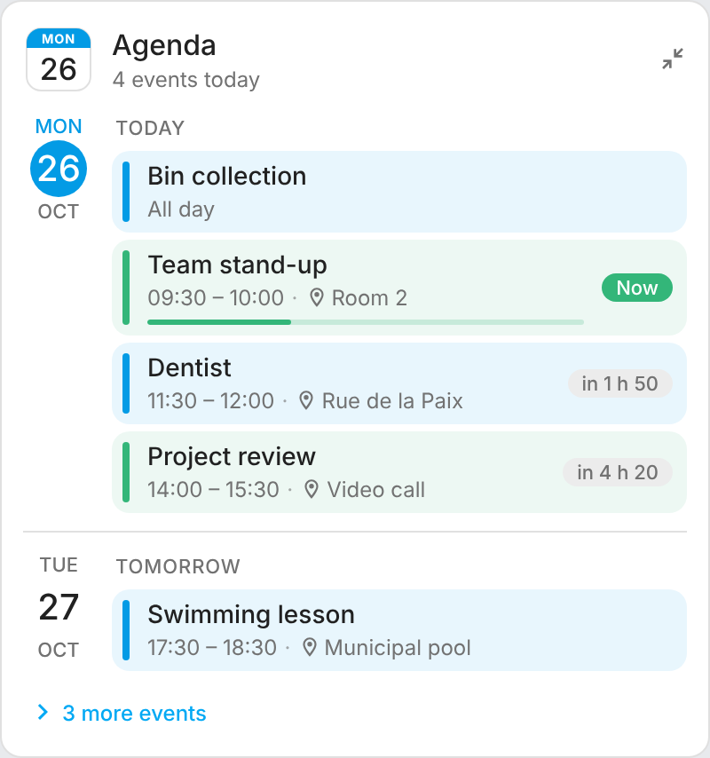

# ha-calendar-card

[](https://github.com/hacs/integration)
[](https://github.com/juju35/ha-calendar-card/actions/workflows/hacs.yml)
[](https://github.com/juju35/ha-calendar-card/actions/workflows/validate.yml)
[](https://github.com/juju35/ha-calendar-card/releases/latest)
[](LICENSE)

Custom Lovelace agenda card for Home Assistant [calendars](https://www.home-assistant.io/integrations/calendar/) (Google Calendar, CalDAV, Local Calendar, Microsoft 365…): the events of one or more calendars, grouped by day, each calendar in its own color, plus a **mini card** with the next event that unfolds into the full agenda.

[](https://my.home-assistant.io/redirect/hacs_repository/?owner=juju35&repository=ha-calendar-card&category=plugin)

| Agenda | Mini card |
|---|---|
|  |  |

## Features

- Two cards: `calendar-agenda-card` and its mini version `calendar-agenda-mini-card` (next event and the one after; a detail button unfolds the full agenda)
- Several calendars merged in one list, each with its own color and name; an event shared by several calendars is listed once
- Days with today and tomorrow labelled, all-day and multi-day events, time range and location
- Countdown for today's events (*in 25 min*, *in 2 h 05*), **Now** badge and progress bar for the event under way; finished events go away
- Events past `max_events` fold into a **N more events** section (chevron right folded, down unfolded, folds back on a click elsewhere)
- Click an event for its details (date and time, location, calendar, description) in a popup at the top of the card
- Hide events by title with `exclude`
- Refreshes when an event starts or ends and every 5 minutes
- Visual editor in the dashboard UI
- English and French, follows the Home Assistant language and 12 h / 24 h time format
- Light and dark theme compatible
- Single file, no dependencies, HACS-ready

## Prerequisites

- Home Assistant 2024.8 or later with at least one `calendar.*` entity

## Installation

### Via HACS (recommended)

Click the button below to add the repository directly:

[](https://my.home-assistant.io/redirect/hacs_repository/?owner=juju35&repository=ha-calendar-card&category=plugin)

Or manually:

1. Open HACS → **Frontend** → **⋮** → **Custom repositories**
2. Add `https://github.com/juju35/ha-calendar-card` — Category: **Dashboard** (Lovelace)
3. Search for **Calendar Card** and install it
4. Clear your browser cache and refresh

HACS registers the dashboard resource for you.

### Manual

1. Download `calendar-card.js` from the [latest release](https://github.com/juju35/ha-calendar-card/releases/latest)
2. Copy it to `/config/www/calendar-card.js`
3. Go to **Settings → Dashboards → Resources** → Add resource:
   - URL: `/local/calendar-card.js`
   - Type: **JavaScript Module**
4. Clear your browser cache and refresh

## Configuration

### Visual editor

Add the card from the dashboard (**Add card** → **Calendar Agenda Card** or **Calendar Agenda Mini Card**). The first calendars found are picked; change them with the **Calendars** field, then set the title, the number of days and the sections to show. Colors and names per calendar are set in YAML; the editor keeps them. Options left at their default are not written to the YAML.

### Minimal

```yaml
type: custom:calendar-agenda-card
entities:
  - calendar.home
  - calendar.work
```

### Mini card

```yaml
type: custom:calendar-agenda-mini-card
entities:
  - calendar.home
  - calendar.work
```

The mini card shows the event under way or the next one (with its countdown), then the one after. The detail button (top right) unfolds the full agenda; a click anywhere else on the page folds it back. It takes the same options as the full card, which apply once unfolded, plus `zoom`.

### Full options

```yaml
type: custom:calendar-agenda-card
title: Family
entities:
  - entity: calendar.home
    color: "#039be5"
    name: Home
  - entity: calendar.work
    color: "#33b679"
  - entity: calendar.public_holidays
    color: "#8e24aa"
    name: Holidays
days_to_show: 7
max_events: 5
show_header: true
show_location: true
show_end_time: true
show_countdown: true
show_empty_days: false
show_past_events: false
exclude:
  - Private
language: en
```

### Options reference

| Option | Required | Default | Description |
|---|---|---|---|
| `entities` | ✅ | — | Calendars: entity IDs, or objects `{ entity, color, name }` |
| `title` | ❌ | `Agenda` | Card title |
| `days_to_show` | ❌ | `7` | Number of days from today (1 to 62) |
| `max_events` | ❌ | `5` | Events shown before the folded **more** section (`0` shows everything) |
| `show_header` | ❌ | `true` | Header with today's date and the number of events today |
| `show_location` | ❌ | `true` | Show the event location |
| `show_end_time` | ❌ | `true` | Show the end time of timed events |
| `show_countdown` | ❌ | `true` | Countdown and **Now** badge for today's events |
| `show_empty_days` | ❌ | `false` | List days without events |
| `show_past_events` | ❌ | `false` | Keep today's finished events (greyed out) |
| `exclude` | ❌ | — | Hide events whose title contains one of these texts (case-insensitive) |
| `zoom` | ❌ | `true` | Mini card only: detail button at the top right that unfolds the full agenda (a click elsewhere folds it back) |
| `language` | ❌ | Auto | Force language: `fr` or `en` (auto-detects from HA settings) |

Calendar options:

| Key | Default | Description |
|---|---|---|
| `entity` | — | `calendar.*` entity |
| `color` | Palette | Any CSS color, used for the bar, background and dot of its events |
| `name` | Entity name | Shown in the event details |

## Screenshots

| Light | Dark (French) |
|---|---|
|  |  |
|  |  |
|  |  |
|  | |

## How it works

The card asks Home Assistant for the events of each calendar between today midnight and `days_to_show` days later (the `/api/calendars/<entity>` endpoint the built-in calendar uses). It fetches again when a calendar entity changes state (an event starts or ends), when the day changes and every 5 minutes; countdowns move on every minute. A calendar that fails to load is named under the list and the others are still shown.

A multi-day event shows on every day it covers. Today's timed events that are over are hidden unless `show_past_events` is on.

## Development

```bash
npm install
npm run build        # stamps the version of package.json into dist/calendar-card.js
npm run check        # builds and checks the card (run in CI)
npm test             # unit tests
npm run screenshots  # renders the cards with mock calendars into screenshots/
```

`dist/` is not committed: `npm run build` creates it locally, CI builds it on every push, and the release workflow attaches the built file to the release, which is where HACS downloads it from.

### Releasing

1. Bump `version` in `package.json`
2. Add a `## <version>` section at the top of [CHANGELOG.md](CHANGELOG.md)
3. Push to `main`: the **Release** workflow builds the card, creates the tag and the GitHub release with the changelog section as notes, and attaches `calendar-card.js`

## Translations

The card auto-detects the language from your Home Assistant settings. Currently supported:

| Language | Code |
|---|---|
| English | `en` |
| Français | `fr` |

Contributions for additional languages are welcome!

## License

[MIT](LICENSE)
